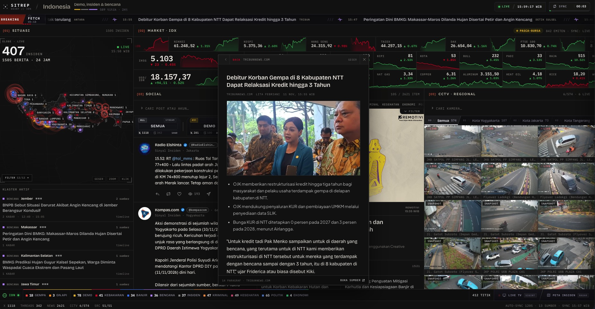
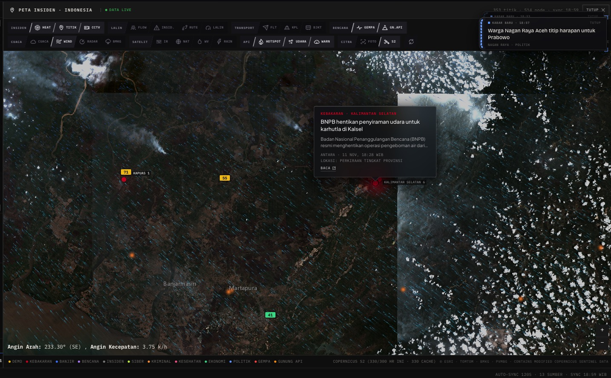

# SITREP — OSINT Console

Real-time situation dashboard for Indonesia: incident news, social signals, disaster tracking, markets, and live CCTV/TV — all in one local-first web console.



## Features

- **News wire** — aggregated RSS feeds with dedup, classification, and a reader that punches through paywalls and bot walls (direct → bot-UA → AMP → proxy → Jina → Firecrawl fallbacks)
- **Social monitor** — X and Threads ingestion with query chips, per-topic lazy fetch, author-diversity caps, and signal clustering
- **Incident map** — BMKG earthquakes, volcano alerts, weather warnings, air quality, wildfire hotspots (NASA FIRMS), TomTom traffic, and situation clustering on a Leaflet map + 3D globe

  
- **Satellite** — Copernicus Sentinel-2 L2A tile proxy (CDSE) with quota caps and disk cache

  
- **CCTV/TV gateway** — HLS/VHS proxy with segment caching, playlist rewriting, and a curated camera catalog (BPJT, Jogja, Molecool, international channels)
- **Markets** — stock/index quotes with trend chips
- **24h retention** — incidents and history persist across restarts via `data/` state

## Stack

- **Backend:** `server.js` — Node.js ≥24, native `http` + `franc` (only runtime dep)
- **Worker:** `vendor/threads_*.py` — Python 3 + `curl_cffi` (pinned in `requirements.txt`)
- **Frontend:** `public/index.html` — single-file vanilla JS/CSS, no build step

## Quickstart

```bash
# needs: node >=24, python3
npm ci
python3 -m venv .venv && .venv/bin/pip install -r requirements.txt

cp .env.example .env   # fill in whatever credentials you have
node server.js         # or: bash start.sh
```

Open `http://localhost:8787`. The frontend auto-detects the API (same-origin, `?api=`, or `localhost:8787`).

By default the server binds to **`127.0.0.1`** in local mode — the dashboard works out of the box via an injected `<meta name="sitrep-token">`, and refuses to bind non-loopback without `SITREP_PUBLIC=1`, `SITREP_USERS`, or explicit `SITREP_ALLOW_LAN_TOKEN=1`. Never commit `.env`.

## Configuration

All secrets come from env / `.env` (auto-loaded by `server.js`, real env wins). The short version:

| Key | Purpose |
|---|---|
| `TOMTOM_API_KEY` | Traffic/routing on the map |
| `AISSTREAM_API_KEY` | AIS vessel stream (WebSocket) |
| `NASA_FIRMS_API_KEY` | Wildfire hotspots |
| `FIRECRAWL_API_KEY` | Reader fallback for anti-bot sites |
| `JINA_API_KEY` | Reader fallback (optional) |
| `CDSE_CLIENT_ID`, `CDSE_CLIENT_SECRET` | Copernicus Sentinel-2 tiles |
| `X_AUTH_TOKEN`, `X_CT0` | X session cookies (multi-account via `X_AUTH_TOKEN_2..10`) |
| `SITREP_PUBLIC` / `SITREP_USERS` / `SITREP_AUTH_SECRET` | Deployment auth modes |
| `PORT` / `SERVER_PORT` | Listen port (default `8787`) |

Everything else — tuning knobs, rate limits, cache sizes, NLP adapter, HLS gateway settings — lives in [`.env.example`](.env.example). `config.json` is non-secret only (hosts, port, CCTV tuning); the server warns at boot if credential-looking fields show up there.

## Security modes

Three fail-closed auth modes, summarized in 10 seconds:

- **Local token (default):** loopback only, token injected into `GET /`. Headless clients use the `x-sitrep-token` header.
- **Public (`SITREP_PUBLIC=1`):** anonymous read-only `viewer` role, no token in HTML. Set `SITREP_TRUST_PROXY=1` behind a reverse proxy.
- **Session (`SITREP_USERS` + `SITREP_AUTH_SECRET`):** login + RBAC (`viewer`/`operator`/`admin`) + CSRF checks for private deployments.

Full model, SSRF/DNS-pinning details, and reporting policy: [`SECURITY.md`](SECURITY.md).

## Project layout

```text
server.js              API + scraping + proxies + WS + auth guard
security.js            SSRF guard, DNS-pinned HTTP/TLS, RBAC, rate-limit
copernicus.js          Sentinel-2 tile proxy + quota + disk cache
cctv-gateway.js        /hls & /vhs gateway, segment cache, coalescing
social*.js             X/Threads ingestion, clustering, history, diagnostics
public/index.html      UI (vanilla JS/CSS, no build)
vendor/                Python Threads scraper (see vendor/THREADS-SCRAPER-LICENSE)
geo/                   Indonesian gazetteer & village index
tests/                 node:test suite — npm test
```

## Deploy

Needs a host with a persistent process + writable filesystem + outbound WebSocket (VPS `systemd`/`pm2`, Railway/Render with a persistent disk, or Docker).

```bash
docker build -t sitrep .
docker run -d --name sitrep -p 8787:8787 \
  -e SITREP_PUBLIC=1 -e SITREP_TRUST_PROXY=1 \
  --env-file .env -v sitrep-data:/app/data \
  sitrep
```

Mount a volume for `/app/data` or history, caches, and market state die on every redeploy.

## Limitations

Honest scope, so you know what you're running:

- **X/Threads coverage is best-effort.** Upstream rate limits and scraper breakage mean quiet periods happen; the UI shows a "collector running" state during cold starts instead of faking data.
- **Social topics are fixed** in `social.js` (`SOC_TOPICS`) — not user-configurable at runtime.
- **CCTV catalog is curated, not exhaustive** — streams die when upstream sources change their URLs.
- **Copernicus tiles are quota-capped** (CDSE free tier) — heavy zoom/pan sessions can hit the daily cap.
- **Single-instance.** No clustering, no multi-tenant isolation — run one process per deployment.
- **News classification is heuristic** (Indonesian keyword/NLP rules) — expect false positives/negatives on edge cases.

## Development

```bash
npm test                      # full suite (tests/*.js)
node scripts/audit-reader.js  # reader audit: [maxPerSource] [baseUrl]
```

See [`CONTRIBUTING.md`](CONTRIBUTING.md) for setup, code rules, and PR expectations.

## License & attribution

SITREP code is MIT — see [`LICENSE`](LICENSE). Vendored code, libraries, and third-party datasets keep their own terms, listed in [`THIRD_PARTY_NOTICES.md`](THIRD_PARTY_NOTICES.md). Notably, `geo/desa-kelurahan-big.json` derives from Indonesian government (BIG) administrative boundary data — verify redistribution terms before mirroring.
